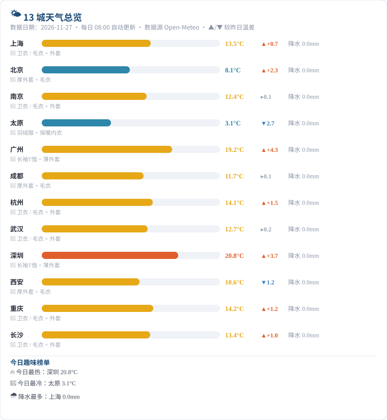
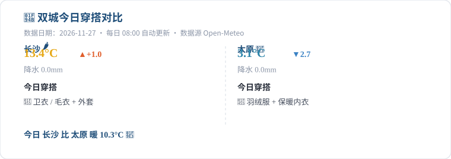
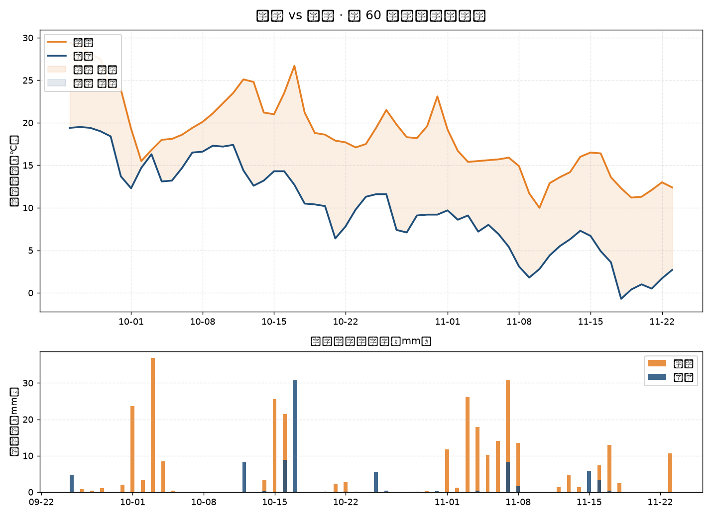
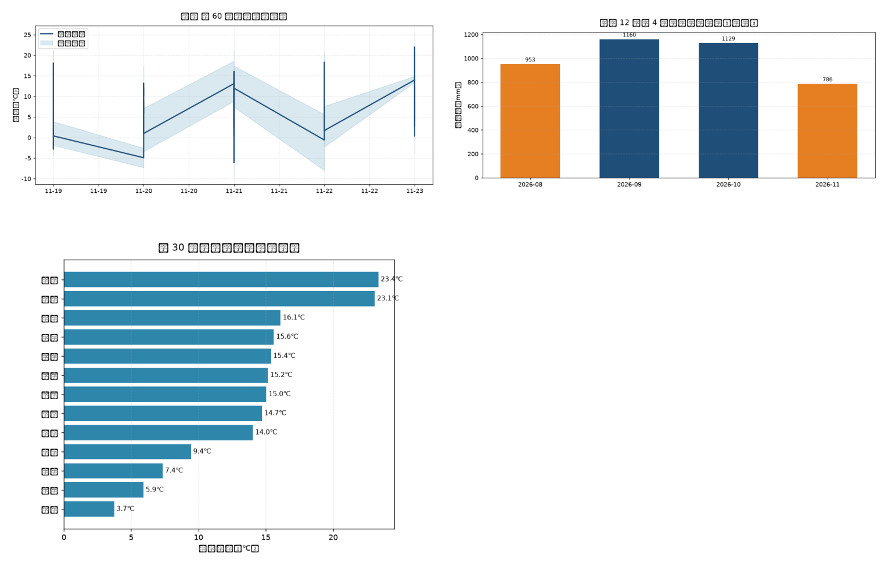
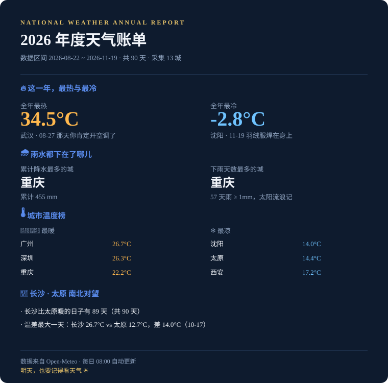

# 天气数据采集与可视化分析系统

[](https://github.com/guiguzi502/weather-collector/actions)  [](https://github.com/guiguzi502/weather-collector/actions)  [](https://github.com/guiguzi502/weather-collector)  [](https://github.com/guiguzi502/weather-collector/actions/workflows/daily.yml)

基于 Open-Meteo 免费开放 API 的端到端数据工程小项目：**采集 → 清洗 → 存储 → 可视化 → 每日自动更新**。

> ⏱ **关于「数据日期」为什么比今天早一天**
> 日统计需要完整 24 小时样本，所以主流程采集的是**已归档的完整日**（`date.today() - 1`）。
> 徽章同时给出 `数据日期`（数据本身到哪天）和 `运行于`（本次执行日期）——后者每天都在变，
> 才说明自动化是活的。归档延迟通常 1 天，偶尔 2 天。

## 🌤 今日天气总览（每天自动刷新）



## 🖥 双城天气对比（长沙 vs 太原）





> 近 60 天：长沙均温 18.5°C / 降水 299mm｜太原均温 10.0°C / 降水 79mm

## 🖥 交互式可视化报告

打开 [weather_report.html](output/weather_report.html) 查看可交互图表（ECharts：趋势/柱状/热力图，支持 hover、缩放、切换）。



## 功能

- **数据采集**：每日定时抓取 13 个中国城市的气温、湿度、降水量等指标（Open-Meteo API，无需 API Key）
- **数据清洗**：缺失值填充、异常值剔除、格式统一
- **数据存储**：SQLite 持久化，支持按城市/日期查询，自动去重
- **可视化分析**：日均气温趋势折线图、近 6 月降水量柱状图、城市温度对比
- **每日自动更新**：GitHub Actions 定时任务，数据落地后自动提交图表

## 快速开始

```bash
pip install -r requirements.txt

# 采集最近 90 天数据并生成图表
python main.py

# 只采集当天数据（增量）
python main.py --days 1

# 指定城市
python main.py --cities 长沙,北京
```

## 🔌 天气数据 API

内置零依赖 API 服务（标准库实现，无需 Flask），把 SQLite 数据暴露为 JSON 接口：

```bash
python api_server.py                      # 启动，默认 127.0.0.1:8000
curl "http://127.0.0.1:8000/api/weather/长沙?days=7"   # 查询长沙近 7 天
curl "http://127.0.0.1:8000/api/cities"               # 城市列表
curl "http://127.0.0.1:8000/"                         # 接口文档页
```

支持 CORS，可直接被浏览器页面调用；接口带自动文档页。

## 项目结构

```
weather-collector/
├── main.py                 # 入口：调度 采集→清洗→存储→可视化
├── config.py               # 城市列表、可视化配置
├── api_server.py           # 零依赖 REST API 服务（标准库）
├── weather/
│   ├── collector.py        # Open-Meteo API 采集（含重试/日志）
│   ├── cleaner.py          # 数据清洗（缺失值/异常值）
│   ├── storage.py          # SQLite 存取，自动去重
│   ├── visualize.py        # Matplotlib 图表生成
│   ├── report.py           # SVG 天气卡 / 双城穿搭卡 / ECharts 报告
│   ├── annual.py           # 年度天气账单 SVG
│   ├── map_view.py         # ECharts 全国省级地图
│   └── sync.py             # output/ → docs/ 统一镜像 + README 引用自检
├── data/                   # SQLite 数据库（自动生成）
├── output/                 # 图表产物唯一落地点（自动生成）
├── docs/                   # README 引用的镜像副本 + 静态 china.json
└── .github/workflows/daily.yml  # 每日 08:00 自动运行
```

> ⚠️ **产物路径约定**：所有图表只由 `output/` 生成，`docs/` 是 README 的镜像目录，
> 由 `weather/sync.py` 统一复制。**不要绕过 `sync_docs()` 直接往 `docs/` 写**——
> 2026-11-23 之前就是这么散的，导致 README 图片停在 11-20 不再更新。

## 核心设计

- **容错重试**：接口异常自动重试 3 次，指数退避，失败记录日志
- **统一 Schema**：多城市数据通过统一的记录结构入库，字段标准化
- **增量更新**：按 (city, date) 去重，重复采集不产生脏数据
- **无人值守**：配合 GitHub Actions 实现每日自动采集与图表更新

## 🗺 全国天气地图（交互式）

打开 [全国天气地图](docs/weather_map.html) 查看交互式中国地图——按省份着色，支持缩放、hover 详情、气温/降水一键切换。

## 📅 年度天气账单（仪式感长图）



> 网易云音乐年度报告风格 · 每年底自动更新 · 最热/最冷/雨都/城市温度榜/双城彩蛋

## 🌟 支持一下

如果这个项目对你有帮助，欢迎点个 **Star** ⭐ —— 每到一个里程碑都会自动记录下来：

📈 [Star 里程碑记录](docs/star_milestones.md)

## 数据来源

[Open-Meteo](https://open-meteo.com/) 提供免费、无需 Key 的历史与实时气象数据，数据来自官方气象机构。

## License

MIT
